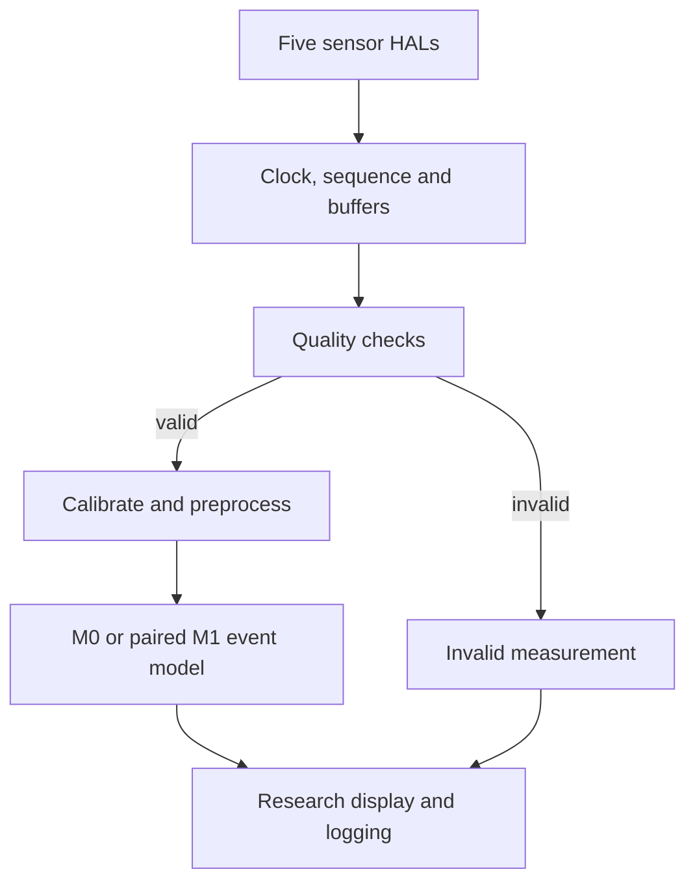

# System architecture

A timestamped acquisition boundary separates physical interfaces from event inference. Python processing is the reproducible research reference; embedded DSP equivalence still requires bench and golden-vector measurements.

## Acquisition contract

Raw rows: `session_id, sample_index, t_us, channel, raw_value, unit, status, sequence`.
A session sidecar records actual measured rates, calibration ID, clock mapping, firmware/model versions, source (`synthetic`, `replayed_research`, `live_bench`), pseudonymous participant where authorized, and immutable recording identity. Labels are separate. Data lineage includes the raw file hash, derived-processing version and split assignment. `t_us` is monotonic; derived public replay timestamps are identified as reconstructed, not measured device timing.

Optical targets 200 Hz; PVDF 8 kHz; sEMG 2 kHz; differential pressure 100 Hz; six inertial channels 200 Hz. All rates are PDF design assumptions. SimulatedHAL generates those counts using a virtual 125-us clock. ESP-IDF schedules synthetic samples in 1-ms batches, which cannot verify real sampling jitter.

The simulated FreeRTOS acquisition task writes a bounded queue; processing maintains quality and a separate logging queue. Overflow latches invalidity. The independent RingBuffer rejects overflow and requires external synchronization if shared across tasks. The logger currently drains synthetic samples and reports counters: no SD writes are claimed. Display is serial research status until TFT controller and pinout are selected.

## Timing and signal processing

Use at least three common-trigger observations to estimate clock slope/offset and residual error. Measure per-filter delay separately. Align physical time, not sample index. Retain per-channel sequence numbers; reject gaps instead of interpolating across missing data. The Python alignment primitive corrects timestamps but does not certify synchronization or assemble asynchronous frames automatically.

Optical preprocessing converts measured, calibrated counts to external displacement and velocity. It does not infer internal laryngeal position. PVDF antialiasing precedes downsampling. EMG has candidate causal bandpass, rectification and envelope filtering. Respiratory pressure stays pressure until pneumatic calibration; baseline/phase/pause and cross-modal timing features remain research work. IMU gating requires bench-calibrated movement thresholds. Generic flatline tests must be configured per modality: a stationary optical target alone is not evidence of sensor failure.

## Memory accounting

Four-second raw float32 channel values require approximately 187,200 bytes before timestamps/status and buffering. Proposed INT8 M1 inputs require 12,400 bytes plus 8 timing-feature bytes. Model weights are separate from tensor arena, stacks, queues, DMA and logging. N16R8 capacity is a board designation, not measured available inference memory. No tensor-arena or target RAM claim is made.

Missing sensor data causes abstention. M1 branches cannot be filled with synthetic physiological signals. No M2 implementation exists.
