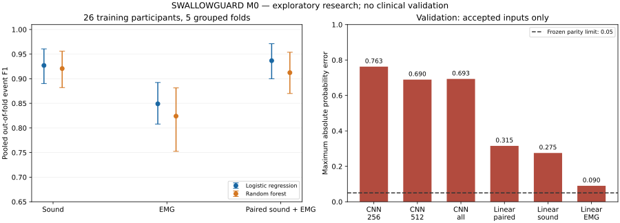

# M0 Research Milestone 02 — numerical failure mechanism and grouped ablation

25 November 2026. **RESEARCH MODE. No candidate in this round passed the frozen numerical acceptance criteria. No clinical or hardware deployment model is approved.**

## Main finding

The previously observed probability discrepancy is reproducible through **internal activation range saturation** for the known outlier. Input-range rejection alone does not protect the CNN across validation participants. Calibrating with more original training data does not make this fixed CNN numerically acceptable under the declared criteria. The correct outcome is to retain the deployment block, while preserving the runnable experiments and their negative results.

The validation-selected M01 random forest reference is unchanged. M1's locked four-branch CNN is unchanged and untrained. M2 remains disabled.

## Numerical controls and intervention

| Control on the previously exposed regression outlier | Event probability |
| --- | ---: |
| Original float CNN | 1.000000 |
| Float CNN after INT8 input quantize/dequantize only | 0.999591 |
| Float CNN after input plus intermediate activation clamping | 0.055557 |
| Actual original INT8 CNN | 0.054688 |

For this case, five of 16 pooled INT8 features hit their upper endpoint. The numerical intervention reproduces the failure closely, supporting internal saturation as a mechanism for this case. It does not establish why the original lower-EMG signal has extreme amplitude, whether a physiological/recording artifact occurred, or whether any swallowing event is clinically safe. Clipped signals are never accepted as valid measurements by this work.

A separate control on all 602 validation clips gives FP32 LiteRT export maximum probability error **5.96e-07** versus the frozen Keras model, with 100% threshold agreement. The original INT8 default and reference kernels give the same aggregate discrepancy. These controls argue against float export corruption or a default-delegate-only explanation; they do not prove every failure has the same mechanism.

Sources: the [official INT8 specification](https://github.com/tensorflow/tensorflow/blob/master/tensorflow/lite/g3doc/performance/quantization_spec.md) defines scale/zero-point representation; the [official quantization debugger API](https://www.tensorflow.org/api_docs/python/tf/lite/experimental/QuantizationDebugger) describes per-layer debugging. This study uses the pinned TensorFlow 2.18.1 interpreter/probes, not a claimed execution of the debugger tool. Our numerical findings are project measurements, not published clinical evidence.

## Frozen validation experiment

The original float model weights, normalization and subject partitions were held fixed. Three CNN calibration schemes used only the original 26 training participants: existing deterministic random 256, subject/class/extrema coverage 512, and all 2,722 training windows. Candidate selection used only the original six validation participants. Protocol and model/input hashes are retained in the JSON results and local pre-evaluation manifests.

The declared thresholds were coverage ≥95%, maximum accepted-input probability error ≤0.05, threshold agreement ≥99%, accepted-subset F1 loss ≤0.01, and model size <100,000 bytes. They are provisional **engineering tolerances**, not validated clinical thresholds. They were not relaxed after observing failures.

After all CNN candidates failed, a separately recorded follow-up mapped the conventional logistic baseline into Dense+sigmoid with its fitted coefficients. Three actual feature sets were tested: paired, sound-only and EMG-only. The two modality-specific follow-ups were recorded before execution and all attempts are reported here; there is no confirmatory model-superiority claim. Original M01 reference selection was not changed.

| Candidate | Model bytes | Accepted / all validation clips | Coverage | Max probability error, accepted | Agreement, accepted | F1, accepted INT8 | Numerical decision |
| --- | ---: | ---: | ---: | ---: | ---: | ---: | --- |
| CNN existing_random256 | 5,736 | 600/602 | 99.67% | 0.7626 | 95.00% | 0.9001 | Rejected |
| CNN subject_class_extrema512 | 5,736 | 600/602 | 99.67% | 0.6895 | 95.83% | 0.8943 | Rejected |
| CNN all_training | 5,736 | 600/602 | 99.67% | 0.6934 | 95.83% | 0.8943 | Rejected |
| Paired linear | 1,352 | 598/602 | 99.34% | 0.3153 | 97.83% | 0.8959 | Rejected |
| Sound linear | 1,336 | 600/602 | 99.67% | 0.2753 | 98.33% | 0.9179 | Rejected |
| EMG linear | 1,344 | 534/602 | 88.70% | 0.0901 | 96.82% | 0.8674 | Rejected |

These F1 values apply to different accepted subsets and must not be compared without coverage. Every report retains a **2×3 confusion matrix** with an explicit abstention column, counts abstentions by true event class, and reports accepted-correct / all-windows. Rejections remain in the denominator. For example, the paired linear comparator abstained on four non-swallow clips; its accepted-only F1 cannot conceal that missing coverage.

No candidate passed all numerical criteria. The evaluation pipelines therefore did **not** run a new regression evaluation for any candidate. The old test split was already exposed in M01, and its known outlier was used only for labelled numerical failure diagnostics, never as a fresh confirmatory holdout or to fit calibration. An independent locked evaluation remains necessary.

## Participant-grouped feature ablation

The companion analysis uses only the original **26 training participants / 2,722 clips**. Five GroupKFold partitions keep all visits from one participant together. The same folds were used for all modalities and both fixed conventional models. Scaling is fitted inside each logistic fold. All data are actual paired D4 sound/sEMG channels; there is no optical or respiratory substitution.

| Feature set / fixed model | Pooled out-of-fold F1 | Participant-cluster 95% CI | Fold F1 range |
| --- | ---: | ---: | ---: |
| sound_only/logistic_regression | 0.9270 | 0.8902–0.9606 | 0.8465–0.9872 |
| sound_only/random_forest | 0.9207 | 0.8820–0.9561 | 0.8564–0.9855 |
| emg_only/logistic_regression | 0.8490 | 0.8079–0.8924 | 0.7823–0.8981 |
| emg_only/random_forest | 0.8240 | 0.7524–0.8813 | 0.7237–0.8858 |
| paired_sound_emg/logistic_regression | 0.9367 | 0.8999–0.9712 | 0.8503–0.9968 |
| paired_sound_emg/random_forest | 0.9123 | 0.8700–0.9538 | 0.8690–0.9887 |

Paired-feature logistic regression gives F1 **0.9367**, CI **0.8999–0.9712**, on development participants. Intervals overlap; the results do not establish statistical superiority, external performance, or the benefit of adding PixArt. Publisher-selected healthy task clips remain different from continuous primary-care screening. The apparent gain over sound-only is modest and model-dependent; random forest does not show the same ordering.



## Implemented changes

- Deterministic training-only representative selection with subject/class/extrema coverage and an explicit budget guard.
- Fixed-signature/frozen-weight conversion helper shared by FP32 controls and INT8 export.
- Strict Python scale/zero-point validation, nonfinite rejection and double-precision input-range comparisons.
- Selective inference/evaluation with abstention, complete denominators, validation-only selection and explicit `None` when no candidate is eligible.
- Reproducible per-layer intervention, FP32/reference-kernel control, range audit, five-fold ablation and exact logistic-to-TinyML mapping CLIs.
- Portable C++ numerical guard that requires physical quality, numerical range and separately passed model validation. It is compiled with the simulated firmware but no real model is enabled.
- Cross-language testing of Python versus C++ decisions on **75 synthetic float32 boundary/random cases**, including nonzero zero points. Synthetic tests never count as physiological performance.

Local verification: **67 Python tests passed**, portable C++ tests passed with undefined-behavior sanitizer, and the optional synthetic INT8 export/operator/parity check passed. The base simulator was already built successfully on ESP32-S3 in [the prior CI run](https://github.com/naohidekiyosawa27/SwallowGuardAI/actions/runs/45459733898). The new branch's target build must be taken from its actual PR checks; local C++ testing is not a target build. No board inference, tensor arena, latency or power measurement was performed.

## Reproduce

Use the prior executed dependency lock and authorized local D4 v2 inputs. No new dataset was downloaded and no paid compute was used. Examples from the repository root:

```bash
python -m swallowguard.evaluate.quant_research /secure/waveforms_clean.npz /secure/cnn_clean docs/protocols/M0_R2_FROZEN.json /secure/r2/quantization
python -m swallowguard.evaluate.grouped_ablation /secure/features_clean.npz /secure/cnn_clean/evaluation.json /secure/r2/ablation.json
python -m swallowguard.evaluate.activation_probe /secure/waveforms_clean.npz /secure/cnn_clean /secure/r2/probe.json --allow-exposed-regression-diagnostic
python -m swallowguard.evaluate.conversion_diagnostic /secure/waveforms_clean.npz /secure/cnn_clean /secure/r2/conversion.json
python -m swallowguard.evaluate.input_audit /secure/waveforms_clean.npz /secure/cnn_clean /secure/r2/input_ranges.json
python -m swallowguard.evaluate.linear_tinyml /secure/features_clean.npz /secure/cnn_clean/evaluation.json docs/protocols/M0_R2_LINEAR_BASELINE.json /secure/r2/linear
python -m swallowguard.evaluate.linear_tinyml /secure/features_clean.npz /secure/cnn_clean/evaluation.json docs/protocols/M0_R2_MODALITY_BASELINES.json /secure/r2/linear_sound --feature-set sound
python -m swallowguard.evaluate.linear_tinyml /secure/features_clean.npz /secure/cnn_clean/evaluation.json docs/protocols/M0_R2_MODALITY_BASELINES.json /secure/r2/linear_emg --feature-set emg
bash scripts/verify.sh
```

The ablation plot uses optional matplotlib. Original data, subject IDs, calibrated model binaries and serialized weights remain outside GitHub. Only code, synthetic fixtures and aggregate results are committed. Dataset attribution remains Kamavuako, Chen and Ismail, D4 v2, DOI 10.18742/33952399.v2, CC BY 4.0.

## Next research gates

1. Design a bounded/QAT or independently validated normalization experiment using training/validation participants, retain all failed comparisons, and specify numerical/abstention thresholds before evaluation. Do not silently replace the locked M1 architecture or promote a rejected M0 export.
2. Acquire genuinely independent data with a suitable access/ethics protocol for confirmation. Existing D4 test reuse is diagnostic, not fresh validation. Additional large public archives still require separate approval.
3. Verify the real optical/AFE/pressure/IMU acquisition chain and timing on a mechanical phantom. Actual hardware and calibration equipment are required for measurements.
4. Link TFLM/ESP-NN and measure target numerical parity, arena/heap/stacks, latency and power only after a model satisfies the laboratory acceptance protocol. The simulator remains model-disabled.
